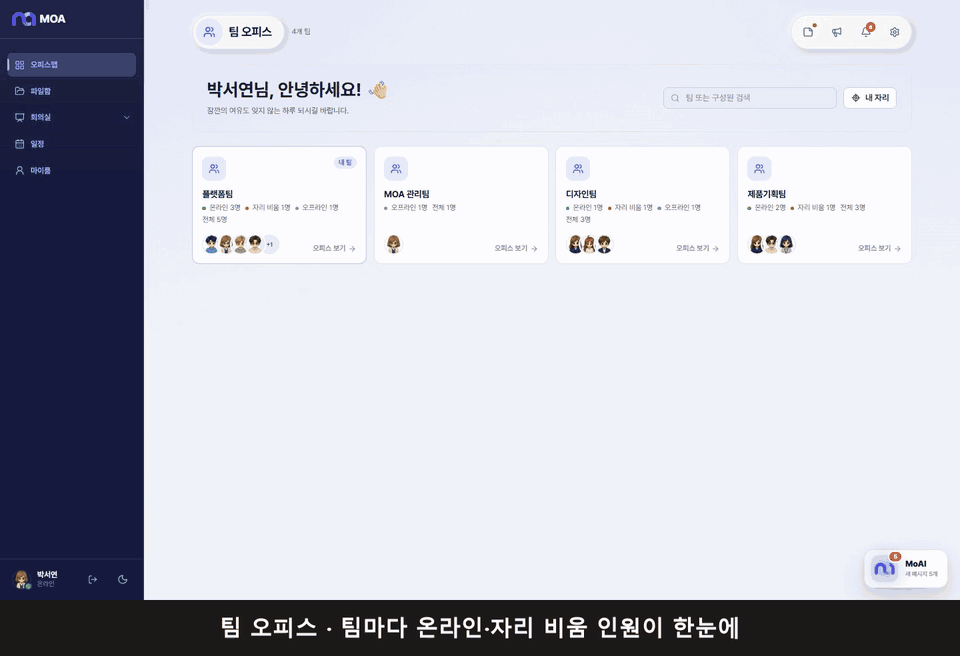
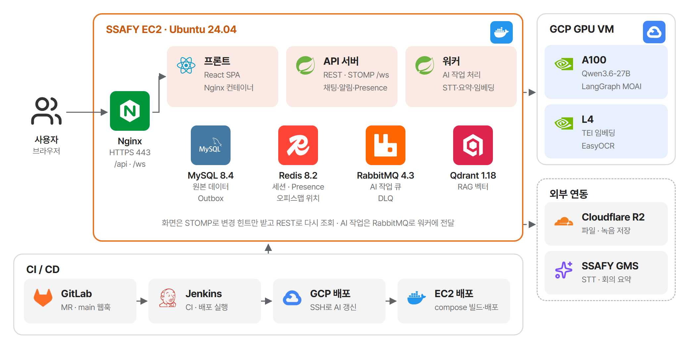
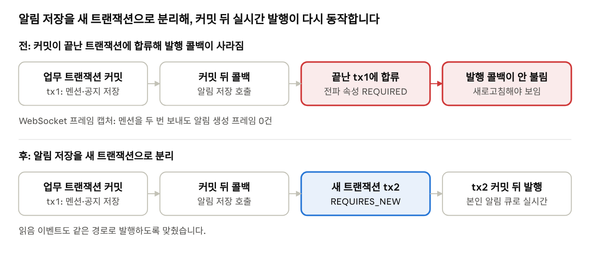
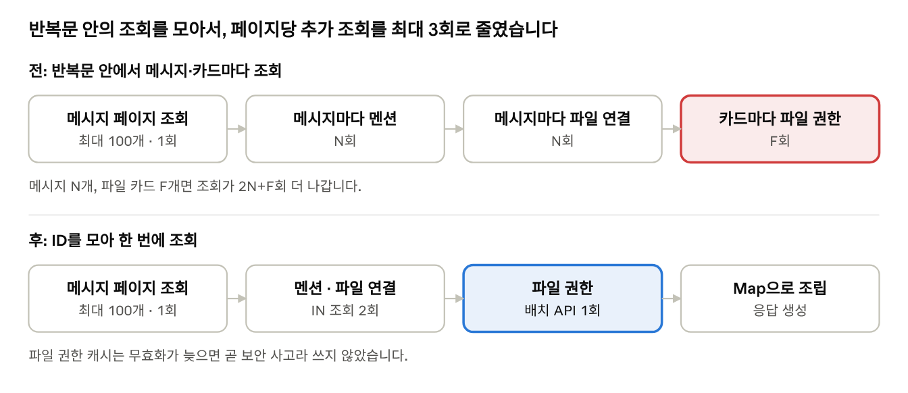
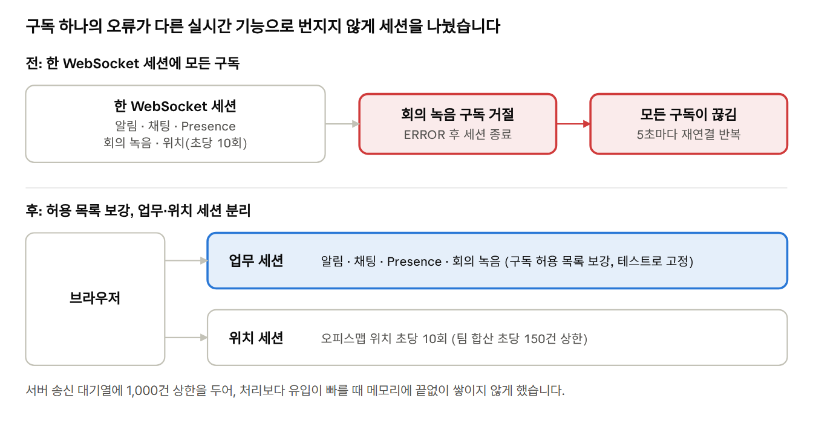
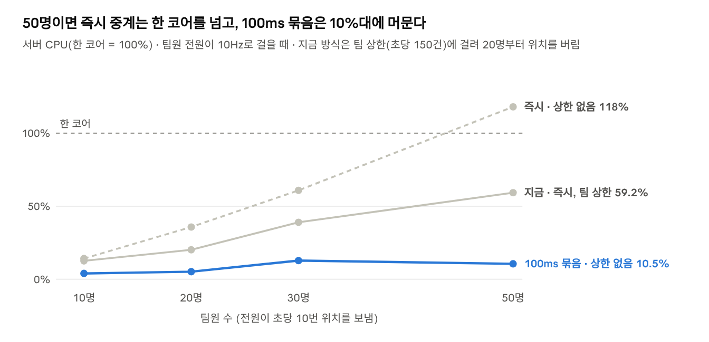

# MOA · My Office Agent

> 사무실의 자리·업무 상태와 채팅·파일·일정·회의를 한곳에 연결한 협업 플랫폼

  

  <a href="서비스개요.md">서비스 개요 (기능별 시연)</a> · <a href="docs/개선_상세.md">개선 상세 (측정 근거)</a>

## 프로젝트 개요

<table>
<thead>
<tr><th nowrap>항목</th><th nowrap>내용</th></tr>
</thead>
<tbody>
<tr><td nowrap>기간</td><td>2026.07.06 ~ 2026.08.10 (5주)</td></tr>
<tr><td nowrap>팀</td><td>6명 (백엔드 3, 프론트 1, 기획 1, AI 평가 1)</td></tr>
<tr><td nowrap>담당</td><td>채팅, 알림, 활동 상태(Presence), WebSocket(STOMP) 실시간 인프라</td></tr>
<tr><td nowrap>수상</td><td nowrap>SSAFY 프로젝트 우수상</td></tr>
<tr><td nowrap>기술</td><td>Java 25, Spring Boot 4.1, MySQL 8.4, Redis 8.2, RabbitMQ, WebSocket(STOMP), Flyway, Testcontainers</td></tr>
</tbody>
</table>

## 내가 한 일

- **채팅**: 채팅방 행 잠금으로 메시지 순번을 매기고, 읽음 위치, 커서·검색 이동, 끊긴 뒤 이어 받기를 구현
- **알림**: 업무 데이터와 같은 트랜잭션에 알림 메시지를 저장하고, 처리 큐(재시도·실패 격리)로 실시간 생성과 읽음을 반영
- **Presence·실시간 인프라**: 여러 탭 접속을 하나로 묶는 접속 상태(Presence)를 만료 시간이 있는 Redis 키로 관리, STOMP 구독 허용 목록, 업무와 위치 채널 분리
- **오픈 직전 운영 결함 대응**: 회의 요약 롤백, 녹음 저장 실패처럼 서비스 오픈을 막던 결함을 다른 도메인까지 찾아 수정

## 전체 아키텍처

- **EC2 한 대**: 프론트·API·워커와 MySQL·Redis·RabbitMQ·Qdrant를 Docker Compose 컨테이너로 운영
- **Nginx(호스트)**: HTTPS 처리, /api·/ws 경로를 API 서버로 전달
- **API 서버**: 화면 요청(REST)과 STOMP 실시간 연결
- **워커**: 녹음 STT·회의 요약·문서 임베딩 같은 AI 작업을 RabbitMQ로 받아 처리, SSAFY GMS 호출
- **GCP GPU VM 2대**: LLM 서빙(A100), 임베딩·OCR(L4), EC2에서 SSH 터널로 연결
- **CI/CD**: GitLab 웹훅 → Jenkins → GCP·EC2 순서로 배포
- **내 담당**: API 서버의 채팅·알림·Presence와 STOMP 실시간 구간

## 핵심 성과

<table>
<thead>
<tr><th nowrap>개선</th><th nowrap>지표</th><th nowrap>전</th><th nowrap>후</th></tr>
</thead>
<tbody>
<tr><td nowrap>알림 실시간 전달</td><td>멘션 2회 뒤 실시간 알림 프레임</td><td nowrap>0건</td><td nowrap>매번 발행</td></tr>
<tr><td nowrap>메시지 조회 배치화</td><td>페이지당 추가 조회 (메시지 N개, 파일 카드 F개)</td><td nowrap>2N+F회</td><td nowrap>최대 3회</td></tr>
<tr><td nowrap>채팅방 목록 조회 (프로젝트 후)</td><td>방 100개, 실제 MySQL</td><td nowrap>SELECT 101회, 140ms</td><td nowrap>2회, 7.5ms</td></tr>
<tr><td nowrap>로그아웃 상태 반영</td><td>OFFLINE으로 바뀌기까지</td><td nowrap>최대 100초</td><td nowrap>즉시</td></tr>
<tr><td nowrap>회의 요약 저장</td><td nowrap>요약 생성</td><td nowrap>0건, 작업 멈춤</td><td nowrap>정상 저장, 알림 도착</td></tr>
</tbody>
</table>

운영 로그, 브라우저 WebSocket 캡처, 쿼리 수로 확인했고, 채팅방 목록만 프로젝트가 끝난 뒤 실제 MySQL로 시간을 쟀습니다.

## 문제 해결

### 1. 저장된 알림이 실시간으로 오지 않던 문제

- **문제**: 멘션과 공지 알림이 새로고침하면 보이는데 실시간으로는 오지 않았습니다. 주기적으로 다시 조회하던 AI 알림 때문에 정상처럼 보였습니다.
- **원인**: 브라우저 프레임을 캡처해 보니 알림 생성 프레임이 없었습니다. 업무 트랜잭션이 커밋된 직후 실행되는 콜백(AFTER_COMMIT) 안에서 저장한 알림이 이미 커밋된 트랜잭션에 합류해, "커밋되면 발행" 이벤트가 끝내 실행되지 않았습니다.
- **해결**: 알림 저장을 새 트랜잭션(REQUIRES_NEW)으로 분리하고, 읽음 이벤트도 같은 경로로 발행했습니다.
- **결과**: 실시간 알림 프레임 0건 → 매번 발행. `fallbackExecution=true`로는 풀리지 않는다는 점도 트러블슈팅 문서로 남겼습니다.

[자세히 보기](docs/개선_상세.md#1-저장된-알림이-실시간으로-오지-않던-문제)

### 2. 채팅 조회 N+1

- **문제**: 메시지 한 페이지(최대 100개)를 읽을 때 멘션·파일 연결은 메시지 수만큼, 파일 권한은 카드 수만큼 따로 조회했습니다.
- **원인**: 목록을 읽은 뒤 항목마다 추가 조회가 붙는 N+1 문제였고, JPA 지연 로딩이 아니라 JDBC 반복문 안의 조회가 원인이었습니다.
- **해결**: 메시지 ID를 모아 `IN` 조회 두 번으로 바꾸고, 파일 권한은 배치 API를 한 번만 불렀습니다. 권한 캐시는 무효화에 실패하면 보안 사고로 이어질 수 있어 쓰지 않았습니다.
- **결과**: 페이지당 추가 조회 2N+F회 → 최대 3회. 프로젝트 후 채팅방 목록에서도 같은 문제를 찾아 방 100개 기준 SELECT 101회 → 2회로 줄였습니다.

[자세히 보기](docs/개선_상세.md#2-채팅-조회-n1)

### 3. 구독 하나가 거절되면 실시간 전체가 끊기던 문제

- **문제**: 회의록 화면에서 5초마다 WebSocket 재연결이 반복됐습니다.
- **원인**: 회의 녹음 알림 큐가 구독 허용 목록(구독해도 되는 주소 목록)에서 빠져 있었고, 서버가 세션을 닫으면 같은 소켓의 알림·채팅·Presence 구독이 모두 끊겼습니다. 초당 10번 오는 위치 프레임도 업무 구독과 같은 세션을 썼습니다.
- **해결**: 허용 목록을 보강해 테스트로 고정하고, 위치 프레임은 별도 WebSocket 세션으로 분리했습니다. 서버 송신 대기열 1,000건, 팀 위치 프레임 초당 150건 상한도 두었습니다.
- **결과**: 반복 재연결이 사라졌고, 위치 프레임이 업무 알림 전달을 방해하지 않게 됐습니다.

[자세히 보기](docs/개선_상세.md#5-구독-하나가-거절되면-실시간-전체가-끊기던-문제)

<b>그 밖의 문제 해결 (5건)</b>

- **회의 요약이 롤백돼 저장되지 않던 문제**: 요청·종결 이벤트의 키 충돌을 분리해 요약 0건 → 정상 저장
- **로그아웃해도 온라인으로 보이던 문제**: 로그아웃 즉시 OFFLINE을 발행해 최대 100초 → 즉시
- **운영 녹음 저장이 전부 실패하던 문제**: presigned PUT 판정 기준을 고치고, 실제 SDK로 재현하는 테스트 추가
- **끊긴 뒤 이어 받기**: 실시간 신호를 놓쳐도 마지막 순번 이후만 REST로 다시 받아 빠짐없이 복구
- **알림 처리 큐**: 처리 중 선점과 재시도 간격, 10번 실패하면 DEAD로 격리해 관리자가 확인

[전체 기록 보기](docs/개선_상세.md)

## 기술 선택 이유

<table>
<thead>
<tr><th nowrap>선택</th><th nowrap>이유</th></tr>
</thead>
<tbody>
<tr><td nowrap>STOMP 신호 + REST 재조회</td><td>신호를 놓쳐도 마지막 순번 이후만 다시 받으면 되게, 데이터는 REST 한 경로로만 가져오려고</td></tr>
<tr><td nowrap>채팅방 행 잠금으로 순번 매기기</td><td>동시에 보낸 메시지도 방 안에서 순서가 하나로 정해지게 하려고</td></tr>
<tr><td nowrap>JdbcTemplate</td><td>락, 조건부 UPDATE, 선점, 커서 쿼리가 많아 SQL을 직접 다루는 편이 명확해서 (결정 문서로 남김)</td></tr>
<tr><td nowrap>Redis TTL 기반 Presence</td><td>여러 탭의 접속 신호를 만료 시간으로 묶어, 끊긴 탭은 자연스럽게 빠지게 하려고</td></tr>
<tr><td nowrap>파일 권한은 캐시하지 않음</td><td>무효화에 실패하면 권한 없는 사람에게 파일이 보일 수 있어서</td></tr>
</tbody>
</table>

## 검토와 제안

**오피스맵 위치 중계를 100ms 단위로 묶는 방안을 실제 서버로 측정하고, 지금 규모에서는 적용하지 않기로 했습니다.** 한 팀 10명에서는 지연이 5ms에서 97ms로 늘어 손해였고, 20명을 넘으면 서버 CPU와 위치 갱신 빈도 모두에서 확실히 이득이었습니다.

[검토 전체 보기](docs/개선_상세.md#개선-검토-오피스맵-위치-중계를-100ms-단위로-묶기)
