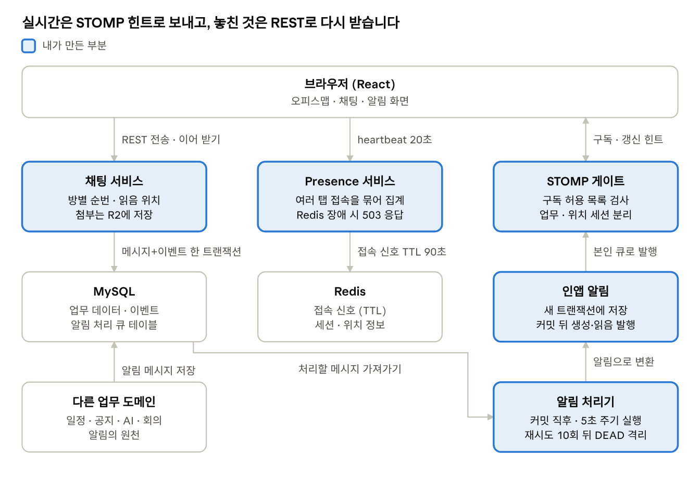
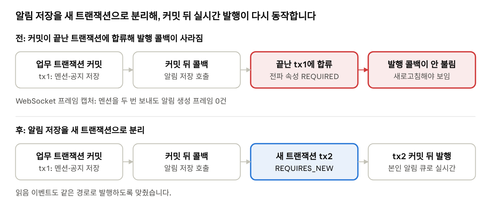
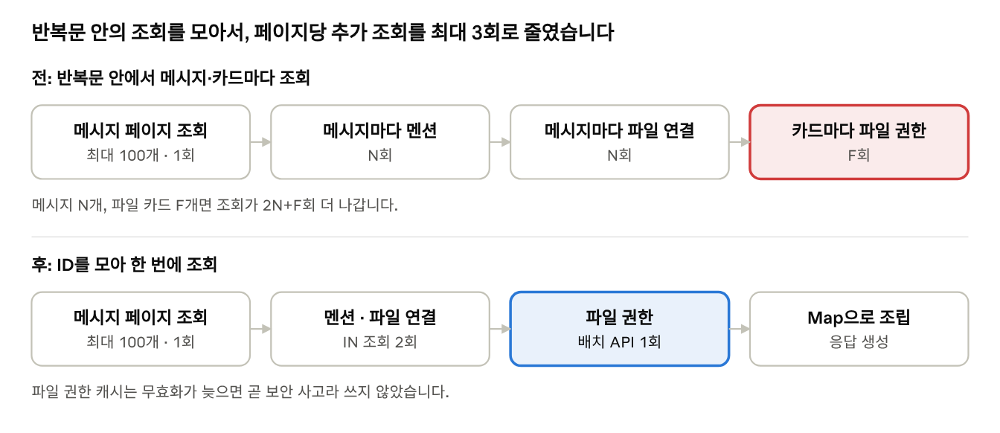
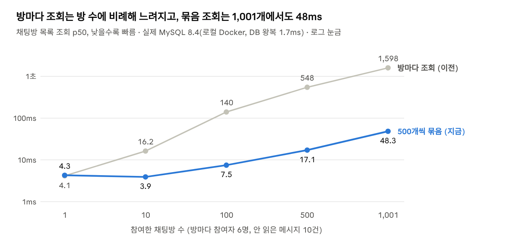
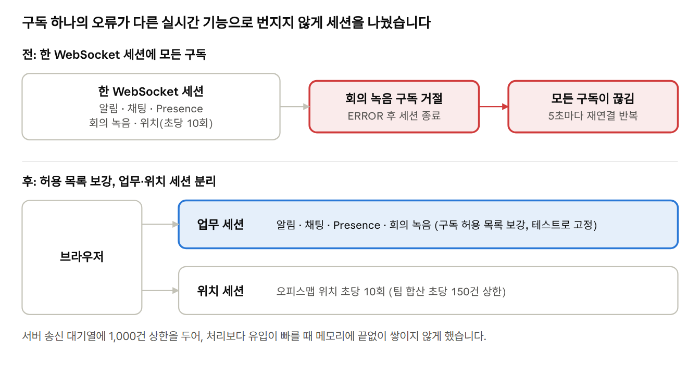
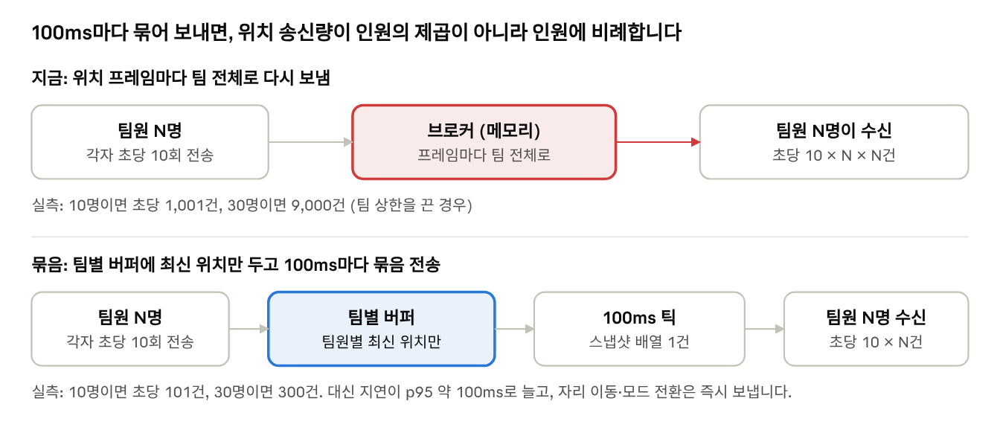
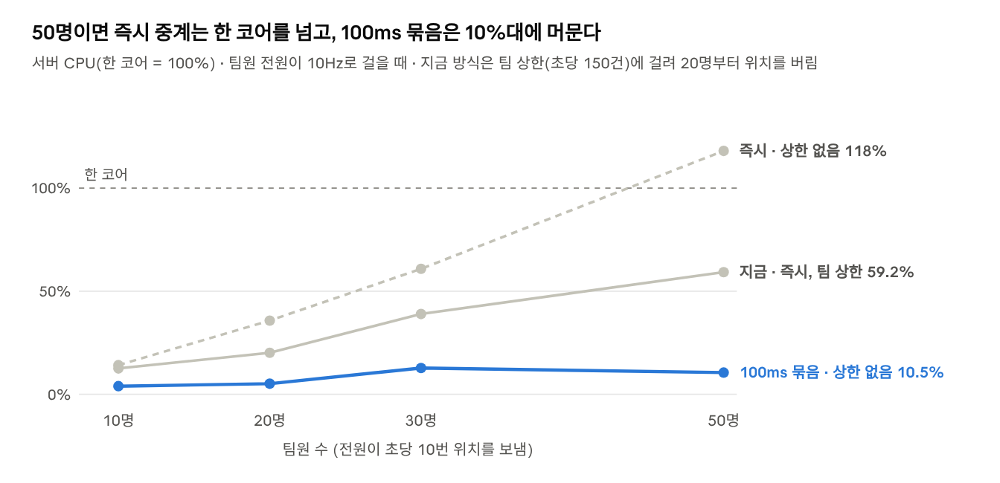

# MOA 개선 상세

[← README로 돌아가기](../README.md)

README에 요약한 문제 해결을 측정 조건과 판단 근거까지 담아 정리한 문서입니다.

## 실시간 협업 백엔드 구조

화면은 WebSocket 위에서 구독·발행을 주고받는 규약인 STOMP로 "데이터가 바뀌었다"는 신호만 받고, 실제 데이터는 REST로 다시 가져옵니다. 이렇게 하면 신호를 놓치더라도 마지막으로 받은 순번 이후만 다시 받으면 됩니다. 알림은 업무 데이터와 같은 트랜잭션에 저장한 메시지로만 만들어지게 했습니다.

### 주요 구현

<table>
<thead>
<tr><th nowrap>영역</th><th nowrap>내용</th></tr>
</thead>
<tbody>
<tr><td nowrap>채팅 순서·복구</td><td>채팅방 행 잠금으로 메시지 순번(roomSeq)을 하나씩 매기고, 이전·이후 커서로 페이지를 읽음. 검색 결과로 이동하면 앞뒤 메시지를 함께 보여 줌</td></tr>
<tr><td nowrap>파일 카드 권한</td><td>권한 없는 파일 카드는 목록에서 가리고, 파일명 검색 결과에서는 아예 빼서 파일이 있다는 사실도 알 수 없게 함. 다운로드할 때 권한을 다시 확인</td></tr>
<tr><td nowrap>알림 신뢰성</td><td>업무 데이터와 알림 메시지를 한 트랜잭션에 저장. 중복 제거 키로 같은 알림이 두 번 생기지 않게 하고, 읽음은 조건부 UPDATE로 처음 바뀔 때만 이벤트 발행</td></tr>
<tr><td nowrap>STOMP 보안</td><td>기본은 거절하고 본인 큐와 권한 있는 회사·팀 토픽만 허용, 브로커로 직접 보내는 것은 금지. 채팅방 공개 토픽을 없애고 참여자별 신호로 전환</td></tr>
<tr><td nowrap>채팅 첨부</td><td>업로드 중, 해시 계산, R2 저장, 재검사, 공개 순서로 처리. 실제 MySQL 통합 테스트 16건으로 기존 코드의 결함 3건을 찾음</td></tr>
<tr><td nowrap>영속성 선택</td><td>락, 조건부 UPDATE, 선점, 커서 쿼리가 많아 JPA 대신 JdbcTemplate을 쓴 이유를 결정 문서로 남김</td></tr>
<tr><td nowrap>보안 로그</td><td>감사 기록 4종을 마이그레이션 없이 읽기 전용 UNION 조회로 통합. 각 쿼리에 LIMIT을 먼저 걸고, AI 대화 본문은 제외</td></tr>
</tbody>
</table>

## 문제 해결과 개선

실시간 기능 문제는 "가끔 안 온다"는 제보로 시작하는 경우가 많았습니다. 재현 조건부터 찾고, 코드와 설정에서 원인을 확인한 다음 테스트로 남겼습니다. 아래 수치는 운영 로그, 브라우저 WebSocket 캡처, 설정값, 쿼리 수로 확인했습니다. 채팅방 목록과 위치 중계만 프로젝트가 끝난 뒤 실제 MySQL과 서버를 띄워 시간을 쟀습니다.

<table>
<thead>
<tr><th nowrap>개선</th><th nowrap>지표</th><th nowrap>전</th><th nowrap>후</th></tr>
</thead>
<tbody>
<tr><td nowrap>알림 실시간 전달</td><td>멘션 2회 뒤 실시간 알림 프레임</td><td nowrap>0건</td><td nowrap>매번 발행</td></tr>
<tr><td nowrap>메시지 조회 배치화</td><td>페이지당 추가 조회 (메시지 N개, 파일 카드 F개)</td><td nowrap>2N+F회</td><td nowrap>최대 3회</td></tr>
<tr><td nowrap>회의 요약 저장</td><td nowrap>요약 생성</td><td>GMS 호출 3번에도 0건, 작업 멈춤</td><td nowrap>정상 저장, 알림 도착</td></tr>
<tr><td nowrap>로그아웃 상태 반영</td><td>OFFLINE으로 바뀌기까지</td><td nowrap>최대 100초</td><td nowrap>즉시</td></tr>
<tr><td nowrap>실시간 채널 분리</td><td nowrap>회의록 화면 재연결</td><td nowrap>5초마다 반복</td><td nowrap>사라짐</td></tr>
<tr><td nowrap>녹음 업로드 판정</td><td nowrap>운영 녹음 저장</td><td nowrap>전부 실패</td><td nowrap>정상</td></tr>
<tr><td nowrap>채팅방 목록 (프로젝트 후)</td><td>방 100개 목록 조회 (실제 MySQL)</td><td nowrap>SELECT 101회, 140ms</td><td nowrap>2회, 7.5ms</td></tr>
</tbody>
</table>

### 1. 저장된 알림이 실시간으로 오지 않던 문제

멘션과 공지 알림이 새로고침하면 보이는데 실시간으로는 오지 않았습니다. AI 알림은 화면이 주기적으로 다시 조회(폴링)하고 있어서 정상처럼 보였을 뿐이었습니다. 브라우저에서 WebSocket 프레임을 캡처해 보니, 멘션을 두 번 보내도 알림 생성 프레임이 하나도 없었습니다.

원인은 트랜잭션 전파였습니다. 커밋 직후 실행되는 콜백(AFTER_COMMIT) 안에서 알림을 저장하면, 이미 커밋됐지만 아직 스레드에 남아 있는 트랜잭션에 합류하게 됩니다. 그래서 알림을 저장한 뒤 "커밋되면 발행"하도록 등록한 이벤트가 끝내 실행되지 않았습니다. 알림 저장을 새 트랜잭션(REQUIRES_NEW)으로 분리하고, 읽음 이벤트도 같은 방식으로 발행하게 맞췄습니다. `fallbackExecution=true`로는 해결되지 않는다는 점도 트러블슈팅 문서에 정리했습니다.

### 2. 채팅 조회 N+1

메시지 한 페이지(최대 100개)를 읽을 때 멘션과 파일 연결은 메시지 수만큼, 파일 권한은 카드 수만큼 따로 조회하고 있었습니다. 목록을 한 번 읽은 뒤 항목 수만큼 추가 조회가 붙는 N+1 문제였고, JPA 지연 로딩이 아니라 JDBC 반복문 안에서 조회를 한 것이 원인이었습니다. 메시지 ID를 모아 `IN` 조회 두 번으로 바꾸고, 파일 권한은 파일 도메인의 배치 API를 한 번만 부르게 했습니다. 파일 권한을 캐시하는 방법도 있었지만, 캐시 무효화에 실패하면 권한 없는 사람에게 파일이 보일 수 있어서 쓰지 않았습니다.

- 페이지당 추가 조회가 2N+F회에서 최대 3회로 줄었습니다. 코드 경로와 서비스 테스트로 확인했습니다.
- 프로젝트가 끝난 뒤 다시 점검하다가 채팅방 목록에도 같은 문제가 남아 있는 것을 찾았습니다. 1+N회 조회를 1+⌈N/500⌉회로 고쳤고, 실제 MySQL로 재 보니 두 방식의 결과는 같으면서 방이 많을수록 차이가 커졌습니다.

방 100개 기준으로 SELECT 횟수가 101회에서 2회로 줄었습니다. 시간은 로컬 Docker 환경(DB 왕복 1.7ms)에서 쟀습니다.

### 3. 회의 요약이 롤백돼 저장되지 않던 문제

운영 환경에서 요약 생성 AI(GMS)가 200 응답을 세 번이나 돌려줬는데도 저장된 요약은 0건이었고, 작업은 실행 중 상태로 멈춰 있었습니다. 요청 이벤트와 종결 이벤트가 같은 키(작업 종류, 작업 ID, 버전 1)를 쓰고 있어서 이벤트 테이블의 유니크 제약에 걸렸고, 그 바람에 요약 저장 전체가 롤백된 것입니다. 실패 처리도 같은 충돌로 실패해서, 재시도할 때마다 AI를 다시 호출하고 있었습니다.

기존 규약에 맞춰 종결 이벤트를 요청 이벤트와 다른 묶음 단위(aggregate)로 분리해 키가 겹치지 않게 하고, 회귀 테스트를 추가했습니다. STT 실패 알림 경로에서도 같은 충돌이 생기지 않도록 함께 고쳤고, 실제로 다시 녹음해 요약 생성과 알림 도착을 확인했습니다.

### 4. 로그아웃해도 온라인으로 보이던 문제

Presence를 끝내는 경로가 없어서, 로그아웃해도 접속 신호(TTL 90초)가 만료되고 정리 작업(10초 주기)이 돌 때까지 최대 100초 동안 온라인으로 보였습니다. 오래 접속해 있던 사용자는 직전 상태 스냅샷이 먼저 만료돼 OFFLINE이 아예 발행되지 않기도 했습니다. 로그아웃할 때 바로 OFFLINE을 보내는 API를 만들고(이 호출이 실패해도 로그아웃은 막지 않습니다), 접속 중임을 알리는 주기 신호(heartbeat)를 받을 때마다 스냅샷 수명도 함께 늘리게 했습니다.

### 5. 구독 하나가 거절되면 실시간 전체가 끊기던 문제

회의 녹음 알림 큐가 구독 허용 목록(구독해도 되는 주소 목록)에서 빠져 있어 구독이 거절됐습니다. 서버는 오류 프레임을 보내고 세션을 닫았는데, 그러면 같은 소켓에 있던 알림, 채팅, Presence 구독까지 모두 끊겼습니다. 그래서 회의록 화면에서는 5초마다 재연결이 반복됐습니다. 초당 10번씩 오는 오피스맵 위치 프레임도 업무 구독과 같은 세션을 쓰고 있었습니다.

허용 목록을 보강해 테스트로 고정하고, 위치 프레임은 별도 WebSocket 세션으로 분리했습니다. 서버 송신 대기열은 1,000건(모든 세션이 함께 쓰는 송신 스레드 풀 큐), 팀 전체 위치 프레임은 초당 150건으로 상한도 두었습니다.

### 6. 운영 녹음 저장이 전부 실패하던 문제

파일 저장소는 다른 도메인의 코드였지만, 서비스 오픈을 막는 결함이라 직접 고쳤습니다. AWS SDK의 `isBrowserExecutable()`은 GET 요청을 기준으로 판단해서, 업로드용 임시 서명 URL(presigned PUT)에서는 항상 false를 돌려줬습니다. 화면에는 "저장소 연결 불가"라고 떴지만, 실제로는 파일 저장소(Cloudflare R2)에 요청이 나가지도 않은 상태였습니다. 서명된 헤더가 허용 범위 안에 있는지로 판정 기준을 바꾸고, 실제 SDK를 쓰되 네트워크 없이 재현하는 테스트를 추가했습니다.

### 그 밖의 사례

- **끊긴 뒤 이어 받기**: 실시간 신호를 놓쳐도 마지막 순번 이후만 REST로 다시 받아 빠짐없이 복구합니다.
- **알림 처리 큐**: 처리 중인 작업은 선점해 두고 재시도 간격을 둡니다. 10번 실패하면 DEAD로 격리해 관리자가 확인할 수 있게 했습니다.

## 개선 검토: 오피스맵 위치 중계를 100ms 단위로 묶기

지금은 위치 프레임이 하나 들어올 때마다 팀 전체에 그대로 다시 보냅니다. 팀원이 N명이고 각자 초당 10번 움직이면 브로커가 보내는 메시지는 10 × N × N건으로, 인원의 제곱에 비례해 늘어납니다. 발신자당 초당 15건, 팀 전체 150건 상한을 두긴 했지만, 지금 쓰는 브로커는 메모리 안에서 도는 단순 브로커(simple broker)라 인원이 늘면 가장 먼저 한계에 닿을 부분입니다.

### 제안

- 팀별 버퍼에 팀원마다 가장 최근 위치 하나만 남기고, 100ms마다 한 번에 묶어 보냅니다.
- 자리 이동이나 모드 전환처럼 놓치면 안 되는 프레임은 바로 보냅니다.
- 화면은 이미 받은 위치 사이를 부드럽게 이어 그리고(보간) 있으므로, 보이는 모습은 크게 달라지지 않습니다.

### 측정 결과와 판단

프로젝트가 끝난 뒤 실제 MOA 서버를 띄우고 로그인한 가상 사용자들을 붙여 측정했습니다. 한 팀이 10명인 지금 규모에서는 개선이 아니었고, 20명을 넘으면 확실한 개선이었습니다.

| 팀원 수 | 방식 | 한 사람 위치 갱신 | 서버 송신 프레임/초 | 지연 p95 |
| --- | --- | --: | --: | --: |
| 10 | 지금 (즉시, 팀 상한) | 10Hz | 1,001 | 5ms |
| 10 | 100ms 묶음 | 약 10Hz | 101 | 97ms |
| 30 | 지금 (즉시, 팀 상한) | 5Hz | 4,500 | 5ms |
| 30 | 100ms 묶음, 상한 없음 | 약 10Hz | 300 | 100ms |
| 50 | 지금 (즉시, 팀 상한) | 3Hz | 7,497 | 9ms |
| 50 | 100ms 묶음, 상한 없음 | 10Hz | 500 | 96ms |

- 10명일 때는 지금 방식도 지연 p95가 5ms였고, 서버 CPU는 한 코어의 12.5%를 썼습니다. 묶으면 CPU는 3.9%로 줄지만 지연이 97ms로 늘어, 얻는 것보다 잃는 것이 더 컸습니다.
- 20명을 넘으면 차이가 분명했습니다. 지금 방식은 팀 상한(초당 150건) 때문에 30명이면 한 사람 위치가 초당 5번, 50명이면 3번으로 떨어졌습니다. 상한을 끄면 50명에서 초당 2.5만 프레임을 보내며 CPU가 한 코어를 넘었습니다(118%). 묶음 방식은 상한 없이도 모두 초당 10번을 지키면서 CPU를 10.5%만 썼습니다.
- 10명 기준으로 계산한 송신량(초당 1,000건에서 100건)과 실제 측정값(1,001건에서 101건)이 일치했습니다.
- 프레임 형식이 바뀌어 화면도 함께 고쳐야 하는 변경이라, 지금 규모에서는 적용하지 않았습니다. 동시에 움직이는 인원이 팀 상한에 닿는 15명을 넘는 팀이 생기면 적용하고, 그때 100ms 지연이 화면 보간에 가려지는지도 함께 확인할 계획입니다.

측정은 MySQL과 Redis 컨테이너로 실제 MOA 서버를 띄워서 했습니다. 실제 STOMP 설정, 권한 확인, Redis 위치 저장이 모두 그대로 동작하는 상태입니다. 묶음 방식은 제품 코드를 바꾸지 않고 테스트에서만 전송을 가로채 흉내 냈습니다. CPU는 서버 스레드 사용량만 합쳤고, 조건마다 8초씩 측정했습니다.
