# MOA 서비스 개요

> 사무실의 자리·업무 상태와 채팅·파일·일정·회의를 한곳에 연결한 협업 플랫폼

[← README로 돌아가기](README.md)

동료가 자리에 있는지, 자료를 어디서 찾아야 하는지, 회의가 어떻게 진행됐는지를 여러 도구에서 따로 확인해야 하는 번거로움을 줄이고자 했습니다. 실제 사무실을 그대로 옮긴 오피스맵에 동료의 접속 상태와 자리 메모를 보여 주고, 채팅, 파일, 일정, 회의, 업무 비서 MOAI를 연결했습니다.

| 기능 | 설명 |
| --- | --- |
| 오피스맵 | 실제 좌석 배치를 옮긴 지도에서 동료의 위치와 상태(온라인, 자리 비움)를 실시간으로 확인 |
| 채팅 | 1:1·단체 채팅, 멘션과 읽음 표시, 파일 카드 공유 |
| 알림 | 멘션, 공지, 일정 초대, AI 작업 완료를 알림함과 실시간 알림으로 전달 |
| 파일·일정·회의 | 파일 접근 권한 관리, 회의실 예약과 일정 초대, 회의 녹음 요약 |
| MOAI | 사내 파일과 회의록에서 근거를 찾아 답하고, 일정·회의실 후보를 제안하는 업무 비서 |

## 1. 구성원 가입과 관리자 승인

<table>
  <tr><th>웹</th><th>모바일</th></tr>
  <tr>
    <td>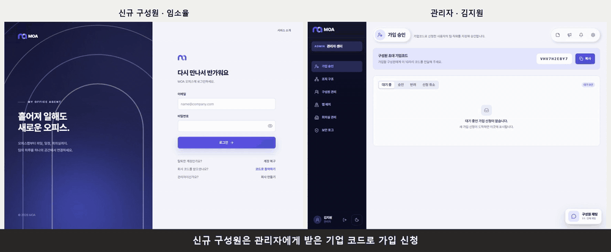</td>
    <td>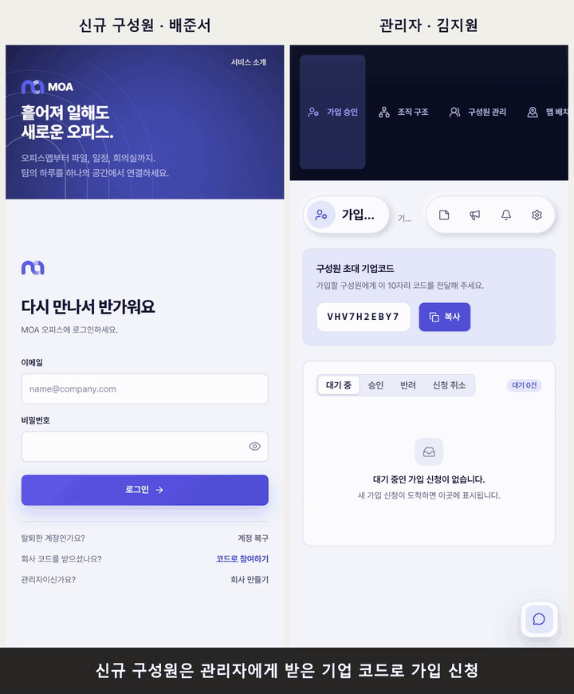</td>
  </tr>
</table>

왼쪽은 새 구성원, 오른쪽은 관리자 화면입니다. 구성원이 회사에서 받은 10자리 기업 코드로 가입을 신청하면, 관리자가 신청을 검토해 팀과 직위를 정하고 승인합니다. 승인되면 신청자는 바로 오피스맵으로 들어갑니다.

## 2. 맵 배치와 좌석 배정

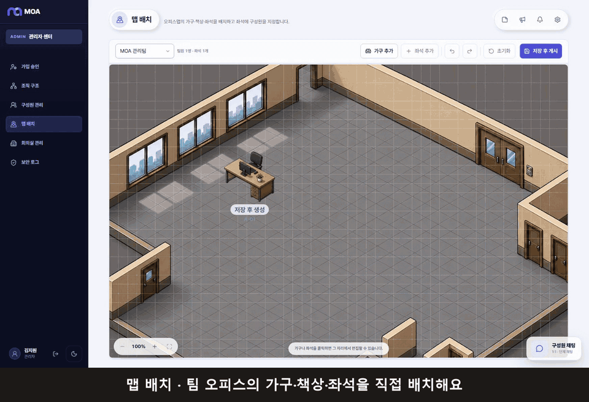

관리자는 배치 편집기에서 책상과 가구를 끌어다 놓아 사무실을 꾸미고, 새로 만든 좌석에 구성원을 배정합니다. 배정된 구성원의 화면에는 바로 내 자리가 생깁니다. 넓은 캔버스에서 끌어 놓는 편집기라 웹으로만 제공합니다.

## 3. 오피스맵 실시간 이동과 채팅

<table>
  <tr><th>웹</th><th>모바일</th></tr>
  <tr>
    <td>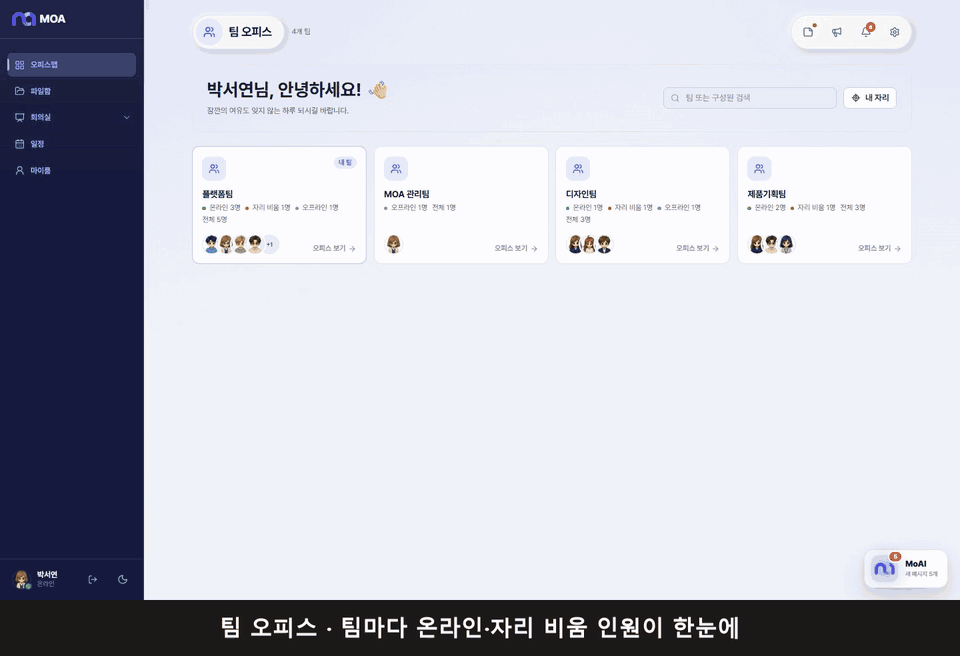</td>
    <td>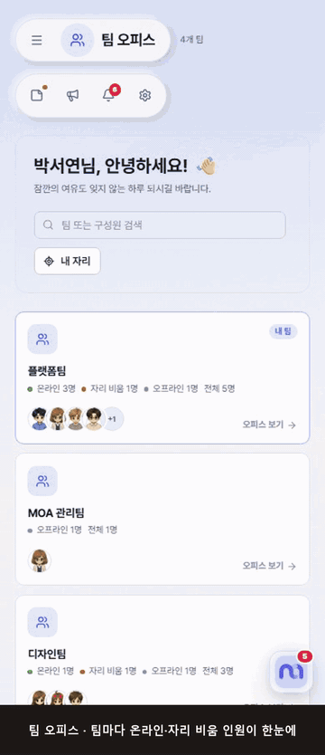</td>
  </tr>
</table>

팀별로 온라인·자리 비움 인원을 보고 팀 오피스로 들어가면, 같은 팀 동료들이 실시간으로 걸어 다니는 모습이 보입니다. 바닥을 눌러 내 캐릭터를 옮기고, 동료 캐릭터를 눌러 1:1 채팅을 시작하면 답장이 바로 도착합니다.

**내 담당**: 접속 상태(Presence) 관리, 채팅, 위치와 메시지를 실시간으로 보내는 WebSocket(STOMP) 연결

## 4. 파일 권한과 채팅 공유

<table>
  <tr><th>웹</th><th>모바일</th></tr>
  <tr>
    <td>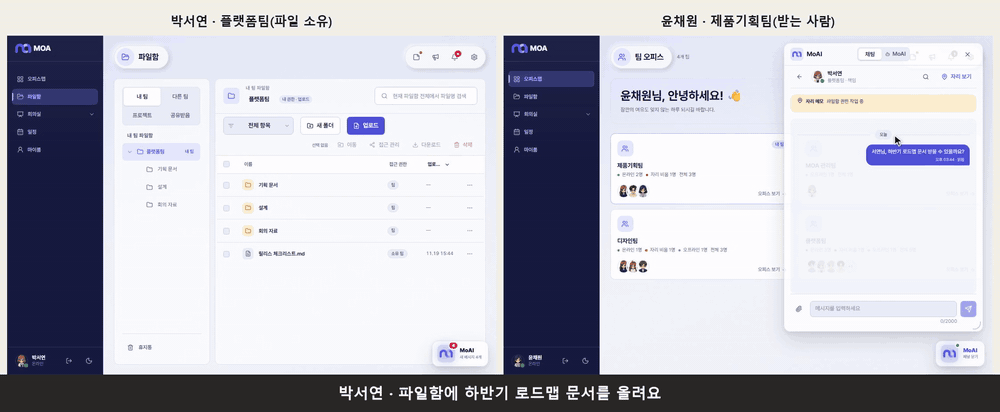</td>
    <td>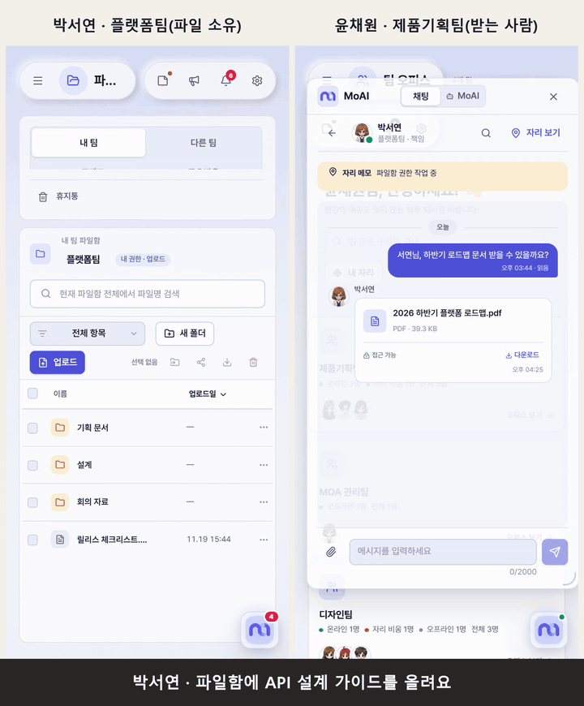</td>
  </tr>
</table>

파일을 올리고 채팅으로 파일 카드를 보내면, 권한이 없는 상대에게는 "접근할 수 없는 파일"로 보입니다. 접근 관리에서 열람 권한을 추가하면 같은 카드가 다운로드 가능 상태로 바뀝니다. 카드를 보여 줄 때마다 서버가 현재 권한을 다시 확인하기 때문입니다.

**내 담당**: 채팅 파일 카드의 권한 재확인, 채팅 첨부 업로드

## 5. 회의실 예약과 일정 초대

<table>
  <tr><th>웹</th><th>모바일</th></tr>
  <tr>
    <td>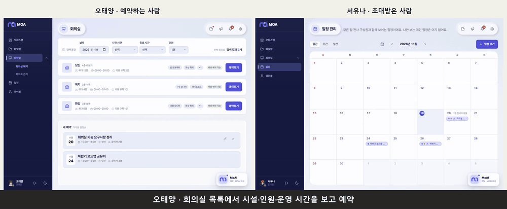</td>
    <td>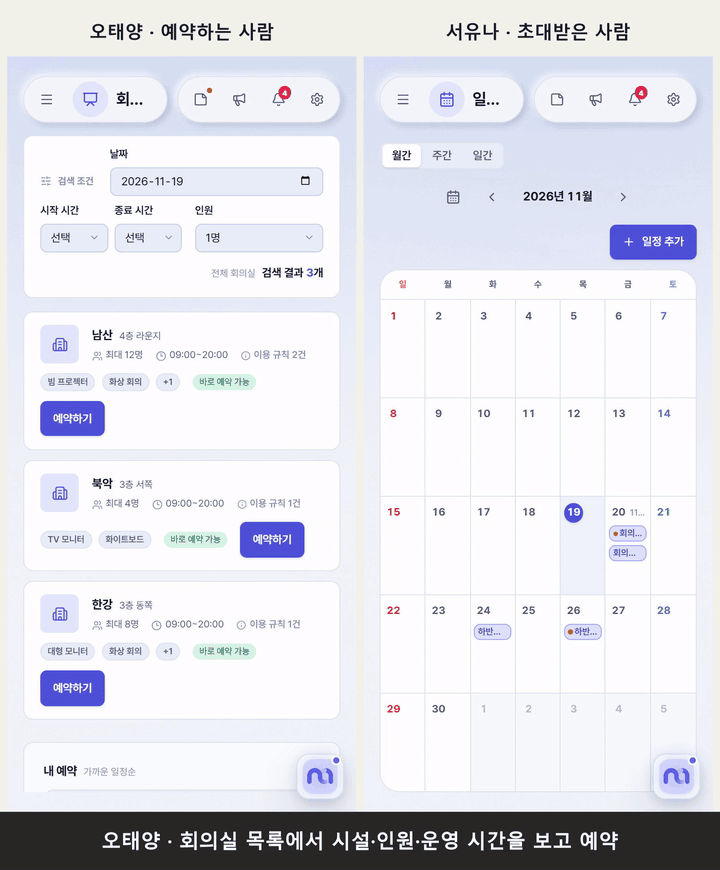</td>
  </tr>
</table>

이미 예약된 시간과 지난 시간을 피해 회의실을 예약하고 참석자를 초대하면, 초대받은 사람에게 알림이 실시간으로 도착하고 일정에도 표시됩니다. 참석 여부를 응답하면 주최자 일정에도 바로 반영됩니다.

**내 담당**: 일정 초대와 응답을 알림으로 바꿔 실시간으로 전달하는 부분

## 6. 회사 공지와 보안 로그

<table>
  <tr><th>웹</th><th>모바일</th></tr>
  <tr>
    <td>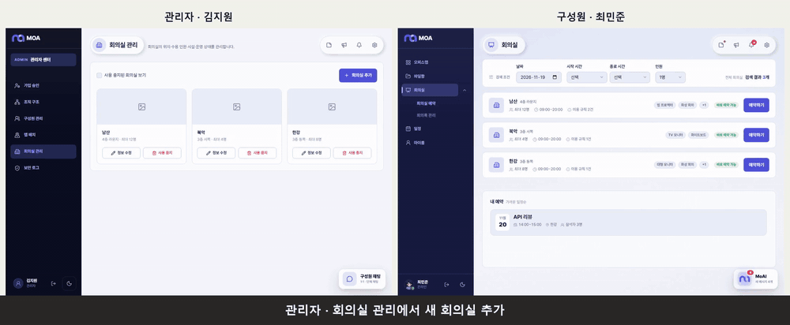</td>
    <td>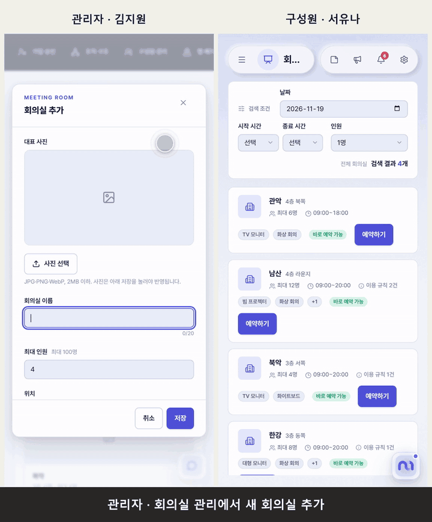</td>
  </tr>
</table>

관리자가 회의실을 추가하면 구성원의 회의실 목록에 바로 나타나고, 회사 공지를 올리면 구성원 화면에 실시간 공지 알림이 뜹니다. 보안 로그에서는 권한 없는 다운로드 시도와 채팅 첨부 기록을 한 화면에서 추적할 수 있습니다.

**내 담당**: 공지 실시간 알림, 흩어져 있던 감사 기록 4종을 한 화면에서 조회하는 보안 로그

## 7. MOAI: 사내 지식 검색과 회의실 후보 제안

| 회의록 기반 답변 | 회의실 예약 후보 |
| --- | --- |
|  |  |

"지난 UI 시안 회의 내용을 알려줘"처럼 물으면, 내가 열람할 수 있는 파일과 참석한 회의의 요약에서 근거를 찾아 답합니다. 일정과 회의실은 조건에 맞는 후보를 먼저 보여 주고, 사용자가 고른 뒤에야 서버가 다시 확인해서 등록합니다. 답변을 만드는 것만으로 일정이 바뀌지 않게 하려는 설계입니다.

## 8. 자리 메모와 알림 설정

| 자리 메모 | 환경설정 |
| --- | --- |
|  |  |

이름 옆에 "외근 중, 3시 복귀"처럼 짧은 메모를 남겨 동료에게 상태를 알릴 수 있습니다. 환경설정에서는 테마, 자리 비움 감지, 알림 종류별 수신 여부를 정합니다.

**내 담당**: 자리 메모, 알림 수신 설정 9종

---

[← README로 돌아가기](README.md) · [개선 상세 보기](docs/개선_상세.md)
